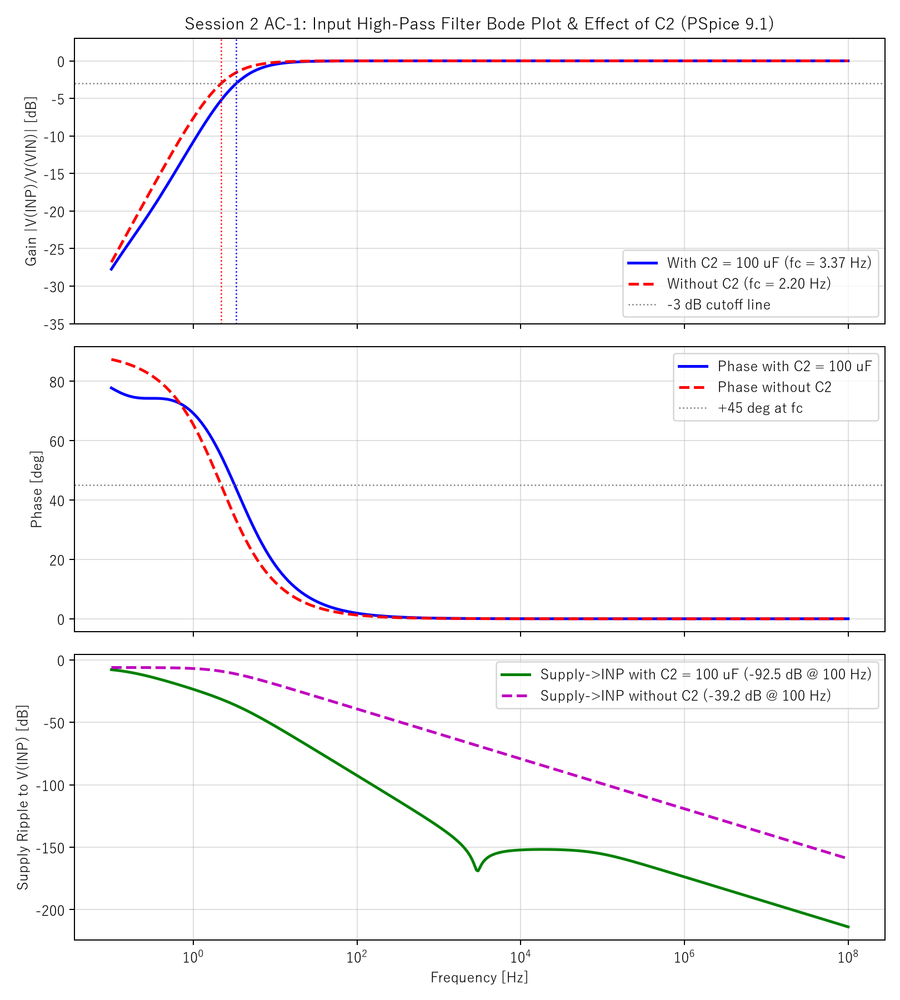
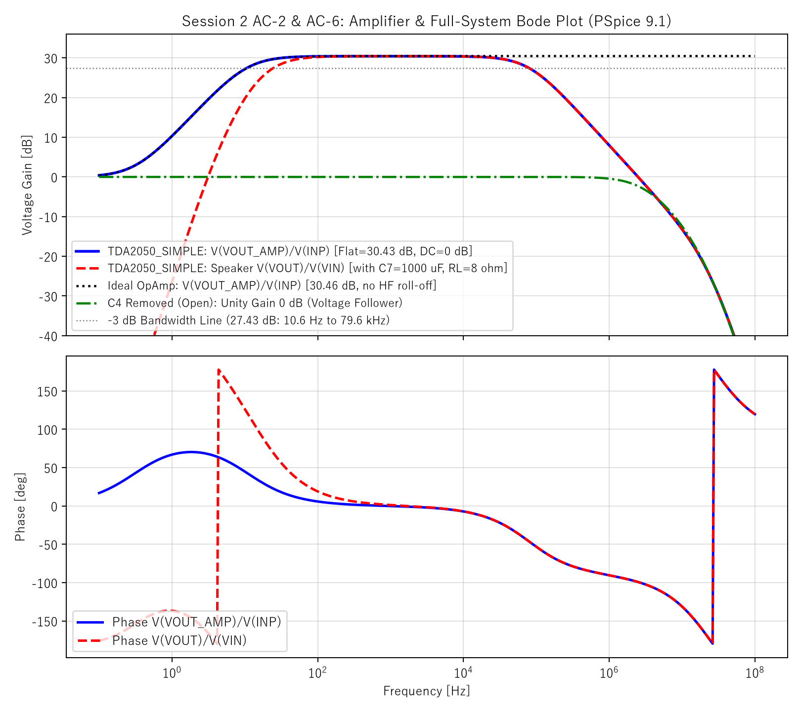
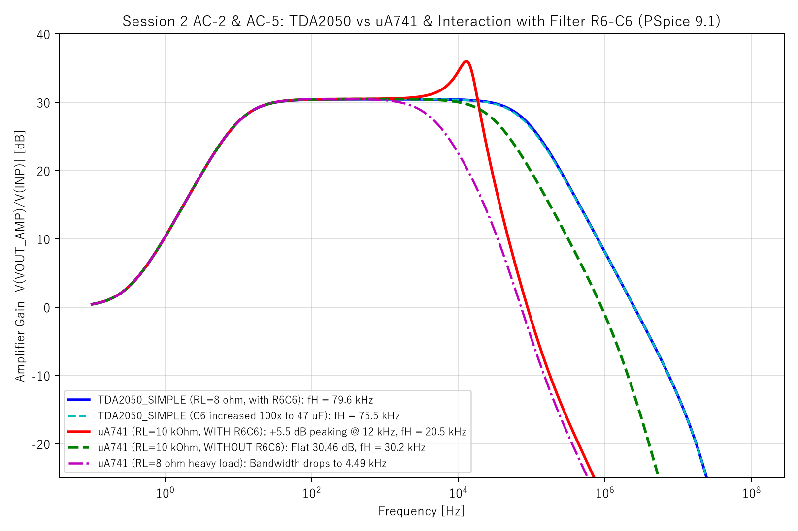
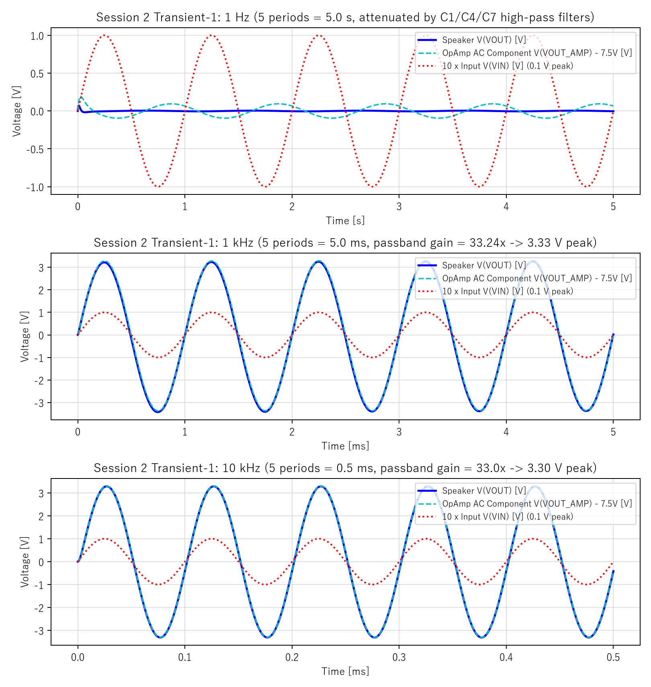
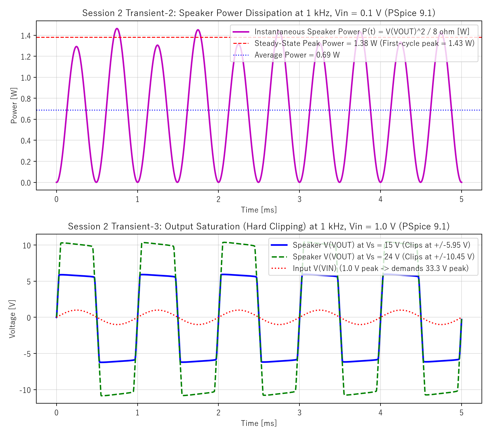
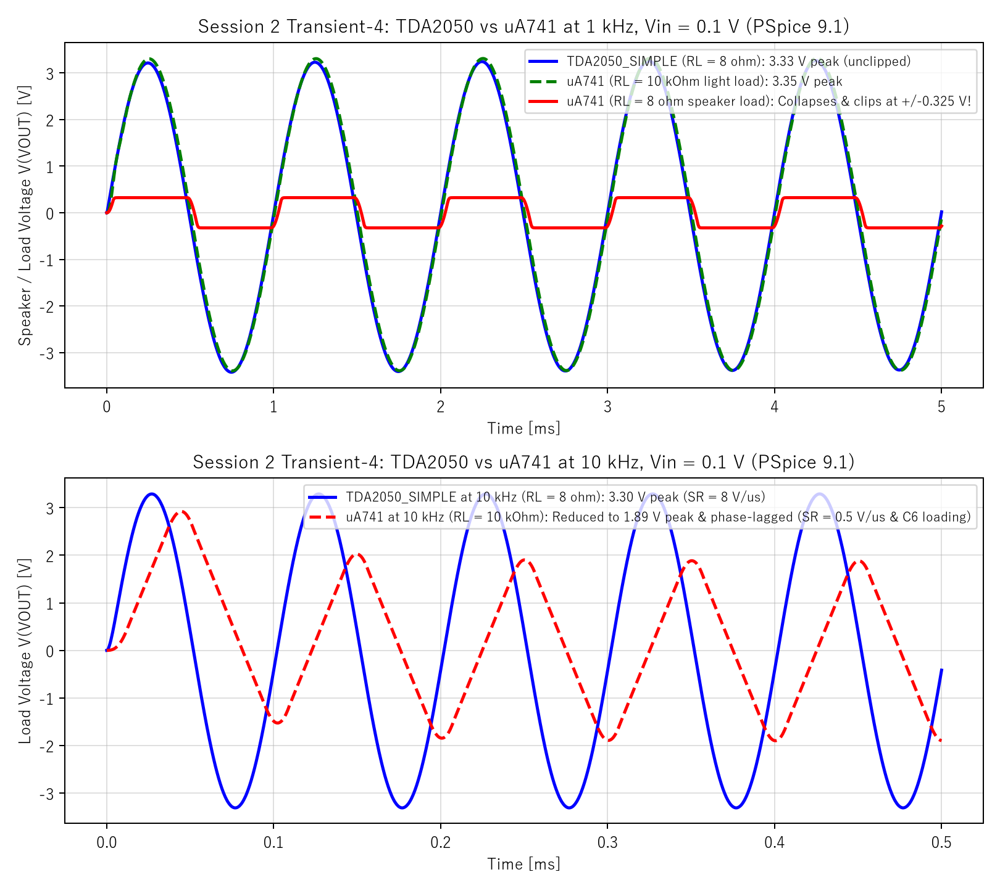

# Electric Circuits Exercises (2026) — Session 1 & Session 2 Complete Logbook

---

## Part 1: Session 1 Objectives & Preparation Notes

### 1. Project Overview & Goals (`ECE_2026_Plan.pdf`)
- **Final Goal**: TDA2050 オーディオパワーアンプ回路と LM317（LM117）リニア電圧レギュレータ電源回路を設計・シミュレーション（PSpice 9.1）・ブレッドボード試作・PCBはんだ付けによって製作し、最終的に単体システムとしてスピーカーを駆動して音楽を再生する。
- **Evaluation**:
  - Hardware demonstration: **40%** (Team)
  - Short report: **20%** (Team)
  - Individual technical discussion (Q&A): **30%** (Individual)
  - Engagement: **10%** (Individual)

---

### 2. Loudspeaker Physics, Electrical Equivalent Model & Human Hearing Range

#### (1) Physical Structure & Electro-Acoustic Transduction Principle
ダイナミックスピーカー（Electrodynamic Loudspeaker）は以下の主要部品で構成される。
1. **Permanent Magnet & Pole Piece / Yoke（永久磁石・磁気回路）**: 磁気ギャップ内に強い放射状の静磁界 $\mathbf{B}$ を形成する。
2. **Voice Coil（ボイスコイル）**: 磁気ギャップ内に配置された円筒状の巻線。アンプから音声の交流電流 $i(t)$ が流れると、**ローレンツ力（アンペールの力）**
   $$F(t) = B \cdot l \cdot i(t)$$
   （$B$: 磁束密度、$l$: 磁界中のコイル有効長）が発生し、電流の向きと大きさに比例して軸方向（前後）に駆動される。
3. **Diaphragm / Cone（振動板・コーン）**: ボイスコイルボビンに直結されており、コイルの前後運動によって周囲の空気を圧縮・膨張させ、**電気信号を音響信号（空気の疎密波＝音圧波）に変換**する。
4. **Suspension（Spider / ダンパー & Surround / エッジ）**: ボイスコイルを磁気ギャップの中心に保持しつつ、変位に対する機械的復元力（バネ定数 $K_m$）と減衰（機械抵抗 $R_m$）を与え、無信号時に振動板を中立位置へ戻す。

#### (2) Equivalent Electrical Circuit Model of a Speaker
- **厳密な電気的等価回路**:
  - ボイスコイルの直流抵抗 $R_e$（例: 約 $6\text{--}7\,\Omega$）とコイルの自己インダクタンス $L_e$（高域でインピーダンス $j\omega L_e$ が上昇する誘導性負荷）の直列回路に、振動板の機械系共振（質量 $M_m$・コンプライアンス $C_m$・機械減衰 $R_m$）が逆起電力 $e_{\text{mot}} = B l v(t)$ として結合した**並列共振回路（$R_{\text{mot}} \parallel L_{\text{mot}} \parallel C_{\text{mot}}$）**が直列接続された形になる。
  - したがって実物のスピーカーのインピーダンス $Z_{\text{speaker}}(f)$ は周波数に依存し、最低共振周波数 $f_0$（通常 $50\text{--}100\text{ Hz}$ 付近）でピークを持ち、また数 $\text{kHz}$ 以上の高周波ではボイスコイルのインダクタンス $L_e$ によって誘導性（Inductive）となりインピーダンスが上昇する。
- **授業のシミュレーションにおける近似モデル**:
  - 基本解析（Session 1・Session 2）では、公称インピーダンス（Nominal Impedance）に等しい純抵抗 **$R_L = 8\,\Omega$** としてモデル化する（Session 3のブレッドボード実験では **$6.8\,\Omega$ の電力抵抗**をダミー負荷として使用する）。

#### (3) Human Audible Frequency Range
- 人間の耳が音として知覚できる可聴周波数帯域（Audible Frequency Range）はおよそ **$20\text{ Hz} \sim 20\text{ kHz}$（$20,000\text{ Hz}$）** である。
- したがってオーディオアンプの通過帯域（$-3\text{ dB}$ 帯域幅）は、少なくともこの $20\text{ Hz} \sim 20\text{ kHz}$ を平坦な利得（Flat-gain）でカバーするように設計する必要がある。

---

### 3. First-Order RC Filters & Operational Amplifier Basics (`OperationalAmplifier2026.pdf`)

#### (1) Passive First-Order RC Filters
コンデンサの複素インピーダンスは $Z_C = \frac{1}{j\omega C} = \frac{1}{j 2\pi f C}$ であり、周波数 $f$ に反比例する（直流 $f=0$ で開放 $|Z_C| \to \infty$、高周波 $f \to \infty$ で短絡 $|Z_C| \to 0$）。

| フィルタ種別 | 回路構成 | 伝達関数 $H(j\omega) = \frac{V_{\text{out}}}{V_{\text{in}}}$ | 遮断周波数（$-3\text{ dB}$ Corner Frequency） | 動作の特徴 |
|---|---|---|---|---|
| **RC Low-Pass Filter (LPF)** | 直列 $R$ → 並列 $C$（$C$ の両端から出力） | $H_{\text{LP}}(j\omega) = \frac{1}{1 + j\omega RC} = \frac{1}{1 + j(f/f_c)}$ | $f_c = \frac{1}{2\pi RC}$ | 低周波（$f \ll f_c$）を通過（$0\text{ dB}$）させ、高周波（$f \gg f_c$）を $-20\text{ dB/dec}$ で減衰させる。$f=f_c$ で $|H|=1/\sqrt{2} \approx 0.707$（$-3.01\text{ dB}$）、位相は $-45^\circ$。 |
| **RC High-Pass Filter (HPF)** | 直列 $C$ → 並列 $R$（$R$ の両端から出力） | $H_{\text{HP}}(j\omega) = \frac{j\omega RC}{1 + j\omega RC} = \frac{j(f/f_c)}{1 + j(f/f_c)}$ | $f_c = \frac{1}{2\pi RC}$ | 直流（$f=0$）を遮断し、低周波（$f \ll f_c$）を $+20\text{ dB/dec}$ の傾きで減衰させ、高周波（$f \gg f_c$）を通過させる。$f=f_c$ で $|H|=1/\sqrt{2}$（$-3.01\text{ dB}$）、位相は $+45^\circ$。 |
| **Band-Pass Filter (BPF)** | HPF（低域遮断 $f_L$）とLPF（高域遮断 $f_H$）の縦続接続（$f_L < f_H$） | $H_{\text{BP}}(j\omega) = H_{\text{HP}}(j\omega) \cdot H_{\text{LP}}(j\omega)$ | 下限 $f_L = \frac{1}{2\pi R_1 C_1}$、上限 $f_H = \frac{1}{2\pi R_2 C_2}$ | $f_L < f < f_H$ の帯域（例: 可聴域 $20\text{ Hz}\text{--}20\text{ kHz}$）のみを通過させ、不要な直流・超低域および超高周波ノイズを除去する。 |

#### (2) Operational Amplifier (Op-Amp) Basics
- **理想オペアンプ（Ideal Op-Amp）の基本特性**:
  1. 開ループ利得が無限大: $G_{OL} \to \infty$（$V_{\text{out}} = G_{OL}(V_{\text{in}+} - V_{\text{in}-})$）
  2. 入力インピーダンスが無限大: $Z_{\text{in}} \to \infty$（入力端子 $+, -$ に流れ込む電流は $I_+ = I_- = 0$）
  3. 出力インピーダンスがゼロ: $Z_{\text{out}} = 0$
  4. 周波数帯域幅が無限大（周波数によらず利得一定）
- **負帰還（Negative Feedback）と仮想短絡（Virtual Short）**:
  - 出力から反転入力端子（$-$）へ負帰還をかけ、出力が電源電圧上限・下限（$V_{CC}, V_{SS}$）で飽和（Saturation）していない線形動作領域では、$\Delta V = V_{\text{in}+} - V_{\text{in}-} = \frac{V_{\text{out}}}{G_{OL}} \to 0$ より **$V_{\text{in}+} \approx V_{\text{in}-}$** となる。
- **非反転増幅回路（Non-Inverting Configuration — TDA2050で採用）**:
  - 入力信号を非反転端子（$+$）に入れ、出力 $V_{\text{out}}$ から帰還インピーダンス $Z_1$（TDA2050回路では $R_5$）と接地側インピーダンス $Z_2$（TDA2050回路では $R_4 + \frac{1}{j\omega C_4}$）で分圧して反転端子（$-$）へ戻す。
  - 閉ループ電圧利得（Closed-Loop Gain）は次式で決まる。
    $$G_{CL}(j\omega) = \frac{V_{\text{out}}}{V_{\text{in}+}} = 1 + \frac{Z_1}{Z_2}$$
- **反転増幅回路（Inverting Configuration）**:
  - 非反転端子（$+$）をGNDに接地（$V_{\text{in}-} \approx V_{\text{in}+} = 0$：**仮想接地 Virtual Ground**）し、入力から $Z_2$ を介して反転端子（$-$）へ信号を入れる。閉ループ利得は $G_{CL} = -\frac{Z_1}{Z_2}$。
- **実在オペアンプの周波数特性（Gain-Bandwidth Product: GBWP）**:
  - 実際のオペアンプは有限の開ループ直流利得 $G_{OL,0}$（TDA2050では $80\text{ dB} = 10^4$）と一次支配極 $f_{p1}$（TDA2050では約 $265\text{ Hz}$）を持ち、高周波では開ループ利得が $-20\text{ dB/dec}$ で低下する。
  - **利得帯域幅積（GBWP = Gain $\times$ Bandwidth）は一定**であるため、閉ループ利得 $G_{CL}$ を高く設定するほど、上限遮断周波数 $f_H \approx \frac{\text{GBWP}}{G_{CL}}$ は低くなる。

---

### 4. Capacitor Technologies & Why $100\text{ nF}$ is Connected in Parallel with $1\text{ mF}$ ($1.0001\text{ mF}$)

#### (1) Comparison of Capacitor Technologies Used in the Circuit
| コンデンサ種類 | 代表的な容量範囲 | 長所（Advantages） | 短所（Limitations） | TDA2050回路での使用箇所 |
|---|---|---|---|---|
| **Electrolytic Capacitor（アルミ電解コンデンサ）** | $1\,\mu\text{F} \sim 10,000\,\mu\text{F}$ | 体積あたりの静電容量が非常に大きく、低周波のエネルギー蓄積・DCカット・バルク電源平滑に最適。 | **極性（Polarity）**があり逆電圧で破損する。巻回構造のため**等価直列インダクタンス（ESL）**と等価直列抵抗（ESR）が大きく、高周波（数十〜数百 $\text{kHz}$ 以上）では誘導性となりコンデンサとして機能しない。容量許容差も大きい（$\pm 20\%$）。 | $C_2\ (100\,\mu\text{F})$, $C_3\ (1000\,\mu\text{F})$, $C_4\ (22\,\mu\text{F})$, $C_7\ (1000\,\mu\text{F})$、（および $C_1\ (2.2\,\mu\text{F})$） |
| **Ceramic Capacitor（セラミックコンデンサ）** | $1\text{ pF} \sim 10\,\mu\text{F}$ | **無極性（Non-polarized）**、小型・安価で、**ESR・ESLが極めて小さい**ため自己共振周波数（SRF）が高く、高周波（数 $\text{MHz}$ 以上）のバイパス・デカップリングに優れる。 | 大容量化が難しく、高誘電率系（X7R等）は直流バイアスや温度による容量変化・圧電効果（マイクロフォニック雑音）がある。 | $C_5\ (100\text{ nF})$ 電源高周波デカップリング |
| **Film Capacitor（フィルムコンデンサ：ポリエステル/ポリプロピレン等）** | $1\text{ nF} \sim 10\,\mu\text{F}$ | **無極性**、絶縁抵抗が高く、誘電正接（損失）・歪みが非常に小さく、電圧や温度に対して容量が極めて安定。 | 電解やセラミックに比べて外形サイズが大きく高価。 | $C_6\ (0.47\,\mu\text{F})$ Zobel発振防止フィルタ、$C_1\ (2.2\,\mu\text{F})$ 入力カップリング |

#### (2) Answer to Session 1 Question: Meaning of Connecting $C_5 = 100\text{ nF}$ in Parallel with $C_3 = 1\text{ mF}$ ($1000\,\mu\text{F}$)
> **Question**: *"In one of the circuit schematics a 100nF capacitor is connected in parallel to a 1mF capacitor, to give an overall value of 1.0001mF: what is the meaning of that (hint: the two capacitors are of different technology types)?!"*

- **結論**: 目的は合成容量を $1.0001\text{ mF}$ に増やすこと**ではなく、異なる2種類のコンデンサ技術（アルミ電解とセラミック）を組み合わせることで、低周波から高周波（RF帯）までの全周波数領域で電源ラインのインピーダンスを低く保つ（広帯域デカップリングを行う）ため**である。
- **物理的理由**:
  1. 実在のコンデンサは理想容量 $C$ だけでなく、内部に**等価直列抵抗（ESR）**と**等価直列インダクタンス（ESL）**を持つ直列RLC回路（$Z(j\omega) = \text{ESR} + j\left(\omega \cdot \text{ESL} - \frac{1}{\omega C}\right)$）として振る舞う。
  2. $C_3 = 1\text{ mF}$（$1000\,\mu\text{F}$）は**アルミ電解コンデンサ**であり、大容量ゆえに低周波（数十 $\text{Hz}$〜数 $\text{kHz}$）の大きな電流変動・電源リップルを吸収できるが、巻回構造のため **ESL が大きく**、自己共振周波数（SRF）を超えた高周波領域では誘導性（$Z \approx j\omega \cdot \text{ESL}$）となってインピーダンスが上昇し、高周波ノイズをバイパスできなくなる。
  3. 一方、$C_5 = 100\text{ nF}$（$0.1\,\mu\text{F}$）は**セラミックコンデンサ**（または無誘導フィルムコンデンサ）であり、容量は小さいものの **ESL・ESR が極めて小さい**ため、電解コンデンサが誘導性になって効かなくなる高周波領域（数百 $\text{kHz}$〜数十 $\text{MHz}$）でも低いインピーダンスを維持し、高周波ノイズをGNDへ逃がしてTDA2050の高周波寄生発振（Oscillation）を防止する。

---

### 5. Detailed Role of Every Component in TDA2050 Single-Supply Circuit (Datasheet Fig. 3 & Fig. 4)

> **注記（データシートの図番号と部品番号について）**:
> `tda2050.pdf` p.6 上段の **Figure 3** が単電源（Single Supply）応用回路図、下段の **Figure 4** がその1:1プリント基板配置図（PCB Layout）である。なお、p.7 の表（Single Supply Application Suggestions）では回路図の $R_4\ (680\,\Omega)$ と $R_5\ (22\text{ k}\Omega)$ の部品番号表記が入れ替わっているが、以下では **Figure 3 / Figure 4 の回路図および Session 2 ガイドラインの表記**に統一する。

| 部品番号 | 定数 | 役割・設計上の意味 | 関連する計算式・遮断周波数 |
|---|---|---|---|
| **$R_1, R_2$** | 各 $22\text{ k}\Omega$ | **単電源用の中点バイアス分圧回路**。単電源（$+V_S$ と GND）で正負両極性の交流音声信号を増幅できるよう、電源電圧の半分 $V_{\text{BIAS}} = \frac{R_2}{R_1+R_2}V_S = \frac{1}{2}V_S$（$V_S=15\text{ V}$ のとき $+7.5\text{ V}$）の直流基準電圧を生成する。 | $V_{\text{BIAS}} = \frac{22\text{k}}{22\text{k}+22\text{k}}V_S = 0.5\,V_S$ |
| **$C_2$** | $100\,\mu\text{F}$ | **バイアス節点 $V_{\text{BIAS}}$ のデカップリング（SVR向上）コンデンサ**。$R_2$ に並列接続され、電源 $+V_S$ に乗った交流リップルやノイズが $R_1\text{--}R_2$ 分圧点から $R_3$ を通ってオペアンプの $+$ 入力へ混入するのを防ぐ（Supply Voltage Rejection の大幅改善）。また交流的に $V_{\text{BIAS}}$ を接地電位（AC GND）に固定する。 | $f_{c,\text{bias}} = \frac{1}{2\pi (R_1 \parallel R_2) C_2} = \frac{1}{2\pi (11\text{ k}\Omega)(100\,\mu\text{F})} \approx \mathbf{0.145\text{ Hz}}$ |
| **$C_1$** | $2.2\,\mu\text{F}$ | **入力DCカット（ACカップリング）コンデンサ**。信号源側の直流成分を遮断してオペアンプの $+7.5\text{ V}$ バイアスが崩れるのを防ぐとともに、$R_3$ とともに**入力1次ハイパスフィルタ（HPF）**を構成する。 | $f_{c,\text{in}} = \frac{1}{2\pi R_3 C_1} = \frac{1}{2\pi (22\text{ k}\Omega)(2.2\,\mu\text{F})} \approx \mathbf{3.29\text{ Hz}}$（PSpice実測: **$3.37\text{ Hz}$**） |
| **$R_3$** | $22\text{ k}\Omega$ | **非反転入力バイアス供給抵抗**。$V_{\text{BIAS}}\ (+7.5\text{ V})$ をTDA2050の非反転入力（Pin 1: $+$）へ供給しつつ、交流信号に対して高い入力インピーダンス（通過帯域で約 $22\text{ k}\Omega$）を確保する。 | $Z_{\text{in}} \approx R_3 \parallel R_{\text{in,IC}} = 22\text{ k}\Omega \parallel 500\text{ k}\Omega \approx 21.1\text{ k}\Omega$ |
| **$R_5$** | $22\text{ k}\Omega$ | **負帰還抵抗（Feedback Resistor）**。出力（Pin 4）から反転入力（Pin 2: $-$）へ負帰還をかけ、$R_4$ との比で通過帯域の閉ループ電圧利得を決定する。 | 通過帯域利得 $G_{\text{flat}} = 1 + \frac{R_5}{R_4} = 1 + \frac{22000}{680} \approx \mathbf{33.35\text{ 倍}}\ (\mathbf{30.46\text{ dB}})$ |
| **$R_4$** | $680\,\Omega$ | **帰還分圧抵抗**。反転入力（Pin 2: $-$）と $C_4$ の間に直列接続され、中・高域での閉ループ利得を $30.46\text{ dB}$ に設定する（TDA2050は安定動作のため閉ループ利得 $24\text{ dB}$ 以上が推奨条件）。 | $R_4$ を小さくすると利得が増加し、大きくすると利得が低下する。 |
| **$C_4$** | $22\,\mu\text{F}$ | **帰還ループ内DCカットコンデンサ**。直流（$f=0$）では開放（$|Z_{C4}| \to \infty$）となるため、直流に対する利得を **$G_{\text{DC}} = 1\text{ 倍}\ (0\text{ dB})$** に抑え、出力端子（Pin 4）の直流動作点を $+V_S/2\ (+7.5\text{ V})$ に保つ。同時に $R_4$ とハイパス特性を形成する。 | $f_{c,\text{fb}} = \frac{1}{2\pi R_4 C_4} = \frac{1}{2\pi (680\,\Omega)(22\,\mu\text{F})} \approx \mathbf{10.64\text{ Hz}}$（PSpice実測: **$10.63\text{ Hz}$**） |
| **$C_3, C_5$** | $1000\,\mu\text{F}$, $100\text{ nF}$ | **電源バイパス（デカップリング）コンデンサ**。$+V_S$ 端子（Pin 5）の直近で低周波（$C_3$）および高周波（$C_5$）の電源インピーダンスを下げ、電圧変動と発振を防ぐ。 | $C_{\text{total}} = 1000\,\mu\text{F} + 0.1\,\mu\text{F} = 1.0001\text{ mF}$ |
| **$R_6, C_6$** | $2.2\,\Omega$, $0.47\,\mu\text{F}$ | **Zobelネットワーク（Boucherotセル / 位相補償RCスナバ）**。高周波で誘導性となりインピーダンスが上がるスピーカー負荷に対し、超高域（$f > 154\text{ kHz}$）で出力端子から見た負荷を約 $2.2\,\Omega$ の純抵抗に近づけ、高周波発振を防止する。 | $f_{c,\text{zobel}} = \frac{1}{2\pi R_6 C_6} = \frac{1}{2\pi (2.2\,\Omega)(0.47\,\mu\text{F})} \approx \mathbf{153.9\text{ kHz}}$ |
| **$C_7$** | $1000\,\mu\text{F}$ | **出力DCカット（スピーカー結合）コンデンサ**。アンプ出力（Pin 4）の直流バイアス電圧（$+V_S/2 = +7.5\text{ V}$）を遮断し、交流の音声信号のみをスピーカー $R_L$ に流す。同時に $R_L$ と**出力ハイパスフィルタ**を構成する。 | $f_{c,\text{out}} = \frac{1}{2\pi R_L C_7} = \frac{1}{2\pi (8\,\Omega)(1000\,\mu\text{F})} \approx \mathbf{19.89\text{ Hz}}$ |
| **$R_L$** | $8\,\Omega$ | **スピーカー負荷モデル**。可聴域の交流電力が供給され音響出力へ変換される。 | 総合下限 $-3\text{ dB}$ 周波数（$C_1, C_4, C_7$ の合成）: PSpice実測 **$24.63\text{ Hz}$** |

---

### 6. PSpice 9.1 Setup & Video Summary (`01_Include_OpAmp_Model.mp4`)
- **このPCでのセットアップ完了事項**:
  1. **PSpice Student 9.1（Schematics GUI）** をインストールし、設定ファイル `PSPICEEV.INI` に `TDA2050_SIMPLE.slb`（回路図シンボル）と `TDA2050_SIMPLE.lib`（シミュレーション用マクロモデル）をグローバル登録済み。
  2. 非管理者権限で `Program Files` 配下にキャッシュ（`global.six` / `global.pix`）を書き込めない問題を解消するため、`PSPICEEV.INI` の `BACKUP` および `UserLib` をユーザー領域（`AppData\Local\OrCAD_Demo\PSpice`）に設定済み。
  3. 1999年製のPSpice 9.1（ANSIアプリ）が日本語を含むパスで文字化けするのを防ぐため、純粋なASCIIパス（ホームディレクトリ直下の `ECE` ジャンクション）から直接このフォルダへアクセスできるように設定し、Schematicsの `File` メニュー（Recent File List 1〜3番）に回路図を登録済み。
- **作成・検証済みのPSpice回路図ファイル（`PSpice_Models/` フォルダ内）**:
  - `PSpice_Models/TDA2050_Amplifier.sch`（TDA2050単電源アンプ本回路、`.cir`, `.out`, `.dat` 生成済）
  - `PSpice_Models/TDA2050_IdealOpAmp.sch`（理想オペアンプ比較用回路、`.cir`, `.out`, `.dat` 生成済）
  - `PSpice_Models/TDA2050_uA741.sch`（Session 2 $\mu\text{A741}$ 比較用回路、`.cir`, `.out`, `.dat` 生成済）

---

## Part 2: Session 2 Complete Analyses, Graphs & Discussion (PSpice 9.1)

> **全数値データとExcelネイティブグラフは `ECE_Session1_Session2_Results.xlsx` の各シートに収録済み。**

---

### A. Frequency (AC) Analysis

#### 1) Input Filter Characterization (`V(INP)/V(VIN)`), Superposition of $C_3, C_5$, and Effect of $C_2$

- **Bode Plot of Input Filter (`V(INP)/V(VIN)`)**:
  - $C_2 = 100\,\mu\text{F}$ がある通常状態では、バイアス節点 $V_{\text{BIAS}}$ は交流的に低インピーダンスで接地されるため、入力から非反転入力端子 `INP` までの回路は **$C_1 = 2.2\,\mu\text{F}$ と $R_3 = 22\text{ k}\Omega$ による1次RCハイパスフィルタ**となる。
  - **理論遮断周波数**:
    $$f_{c,\text{in}} = \frac{1}{2\pi R_3 C_1} = \frac{1}{2\pi \times 22\times 10^3 \times 2.2\times 10^{-6}} = \mathbf{3.288\text{ Hz}}$$
  - **PSpice 9.1 実測値**:
    - $-3\text{ dB}$ 遮断周波数: **$f_{c,\text{in}} = 3.365\text{ Hz}$**（このとき位相は **$+45.0^\circ$**）。
    - $f < 3.37\text{ Hz}$ の低域では $+20\text{ dB/dec}$ の傾き（直流で $-\infty\text{ dB}$、$0.1\text{ Hz}$ で $-30.3\text{ dB}$）で減衰し、通過帯域（$f \ge 30\text{ Hz}$）では利得 **$0.0000\text{ dB}$（$1.000\text{ V/V}$）**、位相差 **$0^\circ$** で入力信号が減衰なく `INP` に伝達される。
- **Influence of $C_3$ and $C_5$ on the Input Signal (Superposition Principle / 重ね合わせの理)**:
  - 重ね合わせの理により、直流電源 $V_S$ の交流変動成分をゼロ（理想電圧源の内部インピーダンス $Z_{V_S} = 0$、すなわち $+V_S$ レールは交流的にGNDと短絡）と置くと、$+V_S$ とGNDの間に並列接続されている **$C_3\ (1000\,\mu\text{F})$ および $C_5\ (100\text{ nF})$ は理想電圧源に並列接続されているため、入力信号 $V_{\text{in}} \to V(\text{INP})$ の伝達特性には一切影響を与えない**。
  - 一方、実回路において電源配線に有限の内部インピーダンス $Z_{\text{supply}}(\omega)$ と電源ノイズ $v_{\text{ripple}}(t)$ が存在する場合、重ね合わせの理で $V_{\text{in}} = 0$ と置くと、$C_3$（低域用電解）と $C_5$（高域用セラミック）が電源レール上のノイズ電圧自体を分流・減衰させ、$R_1 \to R_3$ 経由で `INP` にノイズが飛び込むのを防ぐ役割を果たす。
- **Effect of Capacitor $C_2$ on the Input Signal**:
  1. **入力信号 $V_{\text{in}} \to V(\text{INP})$ に対する影響**:
     - $C_2$ を取り外した場合（Without $C_2$）、交流信号に対して $V_{\text{BIAS}}$ 節点が接地されなくなるため、$R_3\ (22\text{ k}\Omega)$ の先に $R_1 \parallel R_2 = 22\text{ k}\Omega \parallel 22\text{ k}\Omega = 11\text{ k}\Omega$ が直列に加わり、実効抵抗が $R_{\text{eff}} = R_3 + (R_1 \parallel R_2) = 33\text{ k}\Omega$ に増加する。
     - その結果、入力ハイパスフィルタの遮断周波数は
       $$f_{c,\text{no }C_2} = \frac{1}{2\pi (33\text{ k}\Omega)(2.2\,\mu\text{F})} = \mathbf{2.192\text{ Hz}}\quad(\text{PSpice実測: }\mathbf{2.198\text{ Hz}})$$
       へと低下し、入力インピーダンスも $22\text{ k}\Omega \to 33\text{ k}\Omega$ に変化する。
  2. **電源リップル除去比（SVR: Supply Voltage Rejection）に対する決定的な影響（重ね合わせの理）**:
     - 電源 $+V_S$ に $100\text{ Hz}$ の交流リップルが乗った場合、$C_2$ がないと分圧抵抗 $R_1, R_2$ によって電源リップルの約半分が `INP` に入り（PSpice実測で $V(\text{INP})/V_{\text{ripple}} = -39.20\text{ dB}$、スピーカー出力で **$-9.00\text{ dB}$** と大きなハム雑音が出る）、$C_2 = 100\,\mu\text{F}$ を入れると $V(\text{INP})/V_{\text{ripple}} = \mathbf{-92.49\text{ dB}}$（スピーカー出力で **$-59.71\text{ dB}$**）へと **約 $53.3\text{ dB}$（約460倍）も電源ノイズが抑制**される。

---

#### 2) Amplifier Circuit Characterization (`V(VOUT_AMP)/V(INP)`), Flat-Gain, DC Gain, Removing $C_4$, and Role of $R_6C_6$

- **Nominal Gain in the Flat-Gain Region**:
  - 通過帯域（$100\text{ Hz} \sim 10\text{ kHz}$）では $C_4\ (22\,\mu\text{F})$ のインピーダンスが $R_4\ (680\,\Omega)$ より十分小さいため、非反転増幅回路の理論利得は：
    $$G_{\text{flat}} = 1 + \frac{R_5}{R_4} = 1 + \frac{22,000}{680} = \mathbf{33.3529\text{ V/V}} = \mathbf{30.4627\text{ dB}}$$
  - **PSpice 9.1 実測値（$1\text{ kHz}$）**:
    - 理想オペアンプモデル: **$33.35\text{ V/V}$（$30.46\text{ dB}$）**
    - `TDA2050_SIMPLE` モデル（開ループ利得 $80\text{ dB}$、出力抵抗 $0.1\,\Omega$）:
      - アンプ単体 $|V(\text{VOUT\_AMP})/V(\text{INP})| = \mathbf{33.240\text{ V/V}}$（**$30.433\text{ dB}$**）
      - スピーカー負荷 $|V(\text{VOUT})/V(\text{VIN})| = \mathbf{33.237\text{ V/V}}$（**$30.433\text{ dB}$**）
    - **$-3\text{ dB}$ 帯域幅**:
      - アンプ部 `V(VOUT_AMP)/V(INP)`: 下限 **$f_L = 10.63\text{ Hz}$**（理論値 $\frac{1}{2\pi R_4 C_4} = 10.64\text{ Hz}$）〜 上限 **$f_H = 79.60\text{ kHz}$**（理論値 $\frac{\text{GBWP}}{G_{\text{flat}}} = \frac{2.65\text{ MHz}}{33.35} = 79.5\text{ kHz}$）。
      - スピーカー出力 `V(VOUT)/V(VIN)`: $C_7\ (1000\,\mu\text{F})$ と $R_L\ (8\,\Omega)$ のハイパス（$19.89\text{ Hz}$）が加わるため、下限 **$f_L = 24.63\text{ Hz}$** 〜 上限 **$f_H = 79.61\text{ kHz}$**。
- **DC (Zero-Frequency) Gain & What Happens if You Remove $C_4$**:
  - **通常のDC利得（$C_4$ あり）**:
    - 直流（$f = 0\text{ Hz}$）では $C_4$ が開放（$|Z_{C4}| = \infty$）となるため、帰還分圧枝に電流が流れず、$100\%$ 負帰還（ボルテージフォロワ）となって **アンプの直流利得は $G_{\text{DC}} = 1\text{ V/V}\ (0\text{ dB})$** となる（$0.1\text{ Hz}$ でのPSpice実測値: $1.048\text{ V/V} = 0.41\text{ dB}$）。またスピーカー負荷での直流利得は $C_7$ により **$0\text{ V/V}\ (-\infty\text{ dB})$** である。
    - これにより、非反転入力の直流バイアス電圧 $V(\text{INP}) = +7.5\text{ V}$ は1倍で出力され、アンプ出力 `VOUT_AMP` の直流動作点が正しく中点電圧 $+7.5\text{ V}$ に維持される。
  - **$C_4$ を除去した場合の2通りの挙動**:
    1. **$C_4$ を除去して短絡（直結）した場合（`ac_c4_shorted`）**:
       直流でも利得が $33.35\text{ 倍}$ になるため、入力の直流バイアス $+7.5\text{ V}$ を $33.35 \times 7.5\text{ V} = 250.1\text{ V}$ に増幅しようとして、**アンプ出力が正電源側の飽和限界（$V_S=15\text{ V}$ 時に約 $+13.45\text{ V}$）に張り付いて完全に飽和（DC Saturation）する**。その結果、小信号AC利得は **$-164.6\text{ dB}$（事実上ゼロ）** に崩壊し、増幅器として全く動作しなくなる。
    2. **$C_4$ を除去して開放（Open）にした場合（`ac_c4_open`）**:
       $R_4$ の枝が全周波数で切り離されるため、全周波数帯域でボルテージフォロワ（**利得 $G = 1\text{ V/V} = 0.00\text{ dB}$**）となり、音声信号が全く増幅されなくなる。
- **Role of the RC-Filter Associated with $R_6C_6$**:
  - $R_6 = 2.2\,\Omega$ と $C_6 = 0.47\,\mu\text{F}$ の直列回路（コーナー周波数 $f_z = \frac{1}{2\pi R_6 C_6} \approx 153.9\text{ kHz}$）は **Zobelネットワーク（Boucherotセル）** と呼ばれる。
  - 可聴域（$f \le 20\text{ kHz}$）では $|Z_{C6}| \ge 16.9\,\Omega \gg 8\,\Omega$ でほとんど電流を流さないが、スピーカーのボイスコイルインダクタンス $L_e$ によって負荷インピーダンスが上昇する超高域（$f > 150\text{ kHz}$）では $C_6$ が導通して約 $2.2\,\Omega$ の抵抗負荷として働き、高周波での位相回りによる**寄生発振（Oscillation）を抑えて出力を安定化**する。
  - `TDA2050_SIMPLE`（出力抵抗 $0.1\,\Omega$）では $R_6C_6$ を除去しても電圧Bode線図上の変化はわずか（上限 $-3\text{ dB}$ 周波数が $79.6\text{ kHz} \to 78.9\text{ kHz}$）だが、$C_6$ を100倍の $47\,\mu\text{F}$ に増やすと低域側から出力段に重い負荷がかかり帯域が $75.5\text{ kHz}$ に低下する。さらに出力抵抗の大きい $\mu\text{A741}$ では決定的な影響を及ぼす（下記 5) で詳述）。

---

#### 4) How to Provide the User with a Volume Control
ユーザーに音量調節（Volume Control）機能を提供する最も確実で実用的な方法は以下の2通りである。

1. **入力段にポテンショメータ（可変抵抗器 Potentiometer / 音量ボリューム）を配置する方法（推奨・標準）**:
   - 信号源 $V_{\text{in}}$ と入力カップリングコンデンサ $C_1$ の間に、例えば $10\text{ k}\Omega \sim 50\text{ k}\Omega$（人間の聴覚の対数特性に合わせた **Aカーブ / Audio-taper (Logarithmic) ポテンショメータ**）を分圧器（Voltage Divider）として挿入する。
   - 分圧比を $\alpha \in [0, 1]$ とすると、アンプに入る信号振幅が $\alpha V_{\text{in}}$ となり、**アンプ本体の閉ループ利得（$30.46\text{ dB}$）や周波数特性・安定性（TDA2050の最低利得条件 $\ge 24\text{ dB}$）を一切損なわずに、無音（$\alpha=0$）から最大音量（$\alpha=1$）まで連続的に音量を調整できる**。
2. **帰還抵抗 $R_5$（または $R_4$）を可変抵抗にする方法（注意点あり）**:
   - 閉ループ利得 $G = 1 + R_5/R_4$ を直接変える方法だが、TDA2050のデータシート（p.5, p.7 の注記 `(*) The gain must be higher than 24dB`）にある通り、利得を $24\text{ dB}$（約 $15.8\text{ 倍}$）未満に下げると位相余裕が不足して**発振の危険（Danger of Oscillations）**があり、また最小利得でも $1\text{ 倍}$（無音にできない）という欠点がある。したがって**入力アッテネータ方式（方法1）が最適**である（口頭試問での重要ポイント）。

---

#### 5) Replacing Ideal / TDA2050 OpAmp with Realistic $\mu\text{A741}$ (`RL = 10k` vs `RL = 8`) & Re-discussing $R_6C_6$

- **PSpice 9.1 での比較結果（$\mu\text{A741}$, Pin 1・5 未接続, $R_L = 10\text{ k}\Omega > 1\text{ k}\Omega$）**:
  1. **高域帯域幅の低下（GBWPの制限）**:
     - $\mu\text{A741}$ は汎用小信号オペアンプであり、利得帯域幅積が $\text{GBWP} \approx 1\text{ MHz}$（`TDA2050_SIMPLE` の $2.65\text{ MHz}$ の約 $1/2.65$）と小さい。
     - そのため、閉ループ利得 $G_{CL} = 33.35\text{ 倍}$（$30.46\text{ dB}$）における理論上限遮断周波数は
       $$f_{H,\mu\text{A741}} \approx \frac{\text{GBWP}}{G_{CL}} = \frac{1\text{ MHz}}{33.35} \approx \mathbf{30.0\text{ kHz}}$$
       となり、`TDA2050_SIMPLE`（$79.6\text{ kHz}$）や理想オペアンプ（無限大）に比べて高域限界が大幅に低くなる（$R_6C_6$ を外した状態でのPSpice実測値: **$30.21\text{ kHz}$**）。
  2. **$R_6C_6$ フィルタの存在に関する再考察（Re-discussion of Filter $R_6C_6$）**:
     - $\mu\text{A741}$（$R_L = 10\text{ k}\Omega$）に **$R_6\ (2.2\,\Omega)\text{--}C_6\ (0.47\,\mu\text{F})$ を接続したままAC解析を行うと、$10\text{--}12\text{ kHz}$ 付近で利得が $+30.45\text{ dB} \to +35.98\text{ dB}$ へと $+5.5\text{ dB}$ も跳ね上がる共振ピーク（Resonant Peaking）が発生し、その直後に $-40\text{ dB/dec}$ で急激に減衰（$-3\text{ dB}$ 点が $20.53\text{ kHz}$ に低下）する**！
     - **なぜこの現象が起きるのか？**:
       - パワーアンプである TDA2050 は出力インピーダンスが極めて低い（$R_{\text{out}} \approx 0.1\,\Omega$）のに対し、小信号用オペアンプである $\mu\text{A741}$ は**開ループ出力インピーダンスが約 $R_{\text{out,OL}} \approx 150\,\Omega$（`eval.lib` 内の $r_{o1}=50\,\Omega, r_{o2}=100\,\Omega$）と非常に高い**。
       - そのため、出力端子に大容量の $C_6 = 0.47\,\mu\text{F}$（直列抵抗 $R_6 = 2.2\,\Omega \ll 150\,\Omega$）がぶら下がると、$\mu\text{A741}$ の内部出力抵抗 $R_{\text{out,OL}}$ と $C_6$ によって帰還ループ内に追加の極（Pole）
         $$f_{p,\text{load}} = \frac{1}{2\pi (R_{\text{out,OL}} + R_6) C_6} \approx \frac{1}{2\pi (152.2\,\Omega)(0.47\,\mu\text{F})} \approx \mathbf{2.22\text{ kHz}}$$
         が形成され、閉ループ系の**位相余裕（Phase Margin）が失われて2次系の不足減衰共振（Gain Peaking）を引き起こす**。
       - 実際に $R_6C_6$ を取り外すと（上図の緑破線）、この共振ピークは完全に消滅し、理想的な1次ロールオフ（上限 $-3\text{ dB}$ 周波数 **$30.21\text{ kHz}$**）に戻る。つまり **$R_6 = 2.2\,\Omega, C_6 = 0.47\,\mu\text{F}$ という定数は、低出力インピーダンスのパワーアンプ（TDA2050）が $8\,\Omega$ スピーカーを駆動するために設計されたものであり、高出力インピーダンスの小信号オペアンプ（$\mu\text{A741}$）には不適切（容量性負荷として位相余裕を悪化させる）**ことがわかる。

---

#### 6) What is the Role of $C_7$?
- **直流遮断（Output DC Decoupling）**:
  - 単電源動作ではオペアンプ出力端子 `VOUT_AMP` の無信号時電位は $+V_S/2 = +7.5\text{ V}$ である。もし $C_7$ がなければ、無信号時にもスピーカー（$R_L = 8\,\Omega$）に $I_{\text{DC}} = \frac{7.5\text{ V}}{8\,\Omega} = 0.938\text{ A}$ の直流電流が流れ続け、**$P_{\text{DC}} = \frac{7.5^2}{8} = 7.03\text{ W}$ ものジュール熱が常時発生してボイスコイルを焼損させ、さらに振動板が常に一方へ押し出されて正常な振幅運動ができなくなる**。$C_7 = 1000\,\mu\text{F}$ はこの直流成分を完全にカットし、スピーカー端子の平均直流電圧を $0\text{ V}$ に保つ。
- **低域遮断周波数の決定（Output High-Pass Filter）**:
  - $C_7$ とスピーカー負荷 $R_L = 8\,\Omega$ は出力1次ハイパスフィルタを構成し、その遮断周波数は
    $$f_{c,\text{out}} = \frac{1}{2\pi R_L C_7} = \frac{1}{2\pi \times 8\,\Omega \times 1000\,\mu\text{F}} = \mathbf{19.89\text{ Hz}}$$
    となる。$R_L = 8\,\Omega$ と非常に低抵抗であるため、可聴域下限の $20\text{ Hz}$ まで減衰なく通すには $1000\,\mu\text{F}$（$1\text{ mF}$）という大容量の電解コンデンサが必要になる。

---

### B. Time (Transient) Analysis

#### 1) Transient Simulation at $1\text{ Hz}$, $1\text{ kHz}$, $10\text{ kHz}$ ($V_{\text{in}} = 0.1\text{ V}$, 5 Periods Each, Max Step $= T_{\text{sim}}/1000$)

| 周波数 $f$ | シミュレーション時間（5周期） | 最大時間刻み $\Delta t_{\max}$ | 入力振幅 $V_{\text{in,peak}}$ | オペアンプ出力 $V(\text{VOUT\_AMP})$ | スピーカー出力振幅 $V_{\text{out,peak}}$ | 観測結果と理論的考察 |
|---|---|---|---|---|---|---|
| **$1\text{ Hz}$** | $5.0\text{ s}$ | $5.0\text{ ms}$ | $0.100\text{ V}$ | $7.500 \pm 0.095\text{ V}$ | **$0.0048\text{ V}$** ($4.8\text{ mV}$) | $1\text{ Hz}$ は3段のハイパスフィルタ（$f_{c,\text{in}}=3.37\text{ Hz}$, $f_{c,\text{fb}}=10.63\text{ Hz}$, $f_{c,\text{out}}=19.89\text{ Hz}$）の遮断周波数よりはるかに低いため、アンプ出力の交流振幅自体が約 $0.095\text{ V}$ に落ち、さらに $C_7\ (1000\,\mu\text{F})$ で減衰してスピーカーには **$4.8\text{ mV}$（通過帯域の約 $1/700$）** しか現れず、位相も大きく進んでいる。 |
| **$1\text{ kHz}$** | $5.0\text{ ms}$ | $5.0\,\mu\text{s}$ | $0.100\text{ V}$ | $7.47\text{ V} \pm 3.324\text{ V}$（$4.14\text{ V}\sim 10.79\text{ V}$） | **$3.326\text{ V}$**（定常状態; 初周期ピーク $3.385\text{ V}$） | 通過帯域の真ん中であり、利得 $G \approx 33.24\text{ 倍}$（$30.43\text{ dB}$）通り、歪みのない綺麗な正弦波（約 $3.33\text{ V}$ ピーク、入出力同相）がスピーカーに得られる。`VOUT_AMP` の $+7.5\text{ V}$ DCオフセットは $C_7$ によって除去され、`VOUT` は $0\text{ V}$ を中心に振動する。 |
| **$10\text{ kHz}$** | $0.5\text{ ms}$ | $0.5\,\mu\text{s}$ | $0.100\text{ V}$ | $7.50\text{ V} \pm 3.302\text{ V}$（$4.20\text{ V}\sim 10.80\text{ V}$） | **$3.300\text{ V}$** | 上限遮断周波数（$79.6\text{ kHz}$）より十分低く、またスルーレート要求値 $2\pi f V_{\text{peak}} = 2\pi(10\text{ kHz})(3.3\text{ V}) \approx 0.207\text{ V/}\mu\text{s}$ もTDA2050の $8\text{ V/}\mu\text{s}$ より十分小さいため、$1\text{ kHz}$ とほぼ同じ振幅（$3.30\text{ V}$ ピーク）の無歪み正弦波が得られる。 |

---

#### 2) Peak Power Dissipation in the Speaker & Where This Power Comes From

- **Peak & Average Power Dissipation in the $8\,\Omega$ Speaker ($V_{\text{in}} = 0.1\text{ V}$, $f = 1\text{ kHz}$)**:
  - 定常状態でのスピーカー出力電圧ピーク値は $V_{\text{out,peak}} \approx 3.324\text{ V}$（過渡第1周期の最大ピークでは $3.385\text{ V}$）、スピーカー電流ピーク値は $I_{L,\text{peak}} = \frac{V_{\text{out,peak}}}{R_L} = \frac{3.324\text{ V}}{8\,\Omega} = 0.4155\text{ A}$ である。
  - **瞬時最大消費電力（Peak Power Dissipation）**:
    $$P_{\text{peak}} = \frac{V_{\text{out,peak}}^2}{R_L} = \frac{(3.324\text{ V})^2}{8\,\Omega} = \mathbf{1.381\text{ W}}\quad(\text{過渡初周期の最大瞬時値: }\mathbf{1.432\text{ W}})$$
  - **平均消費電力（Average / RMS Power Dissipation）**:
    $$P_{\text{avg}} = \frac{V_{\text{out,rms}}^2}{R_L} = \frac{1}{2} P_{\text{peak}} = \frac{(3.324/\sqrt{2})^2}{8\,\Omega} = \mathbf{0.691\text{ W}}\quad(\text{PSpice実測平均: }\mathbf{0.688\text{ W}})$$
- **Where Does This Power Come From?（この電力はどこから供給されるか？）**:
  - 入力信号源 $V_{\text{in}}$ が供給する電力は $P_{\text{in,peak}} \approx \frac{V_{\text{in,peak}}^2}{R_3} = \frac{(0.1\text{ V})^2}{22\text{ k}\Omega} \approx 0.45\,\mu\text{W}$ に過ぎない。
  - スピーカーで消費される $1.38\text{ W}$（平均 $0.69\text{ W}$）の電力は、**オペアンプの電源端子（Pin 5: $+V_S$）に接続された直流電源（DC Power Supply $V_S$）から供給される**。オペアンプ内部の出力段トランジスタが、小信号入力 $V_{\text{in}}$ に応じて直流電源 $V_S$ から引き出す電流を変調し、直流電力を交流信号電力および熱損失へと変換している（Energy conservation: $P_{\text{DC supply}} = P_{\text{speaker}} + P_{\text{heat in IC}}$）。

---

#### 3) Increasing Signal Amplitude to $1\text{ V}$ & Expected Acoustic Result
- **回路の電気的挙動（Saturation / Hard Clipping）**:
  - 入力振幅を $V_{\text{in,peak}} = 1.0\text{ V}$ に増やすと、線形利得 $33.35\text{ 倍}$ では出力に $\pm 33.35\text{ V}$ の振幅（ピーク・ツー・ピークで $66.7\text{ V}_{\text{pp}}$）が要求される。
  - しかし単電源 $V_S = 15\text{ V}$ の場合、TDA2050の出力電圧範囲は電源レールから上下約 $1.55\text{ V}$（Headroom）内側までに制限されるため、アンプ出力 `VOUT_AMP` は **$1.55\text{ V} \sim 13.45\text{ V}$** で頭打ちとなり、$C_7$ を通過したスピーカー電圧 `VOUT` は **$\pm 5.95\text{ V}$（最大時約 $\pm 6.0\text{ V}$）で上下が平らに潰れた台形波／矩形波状のハードクリッピング（Hard Clipping / Saturation）波形**となる（$V_S = 24\text{ V}$ の場合でも $\pm 10.45\text{ V}$ で同様にクリップする）。
  - このときスピーカーの瞬時最大電力は $P_{\text{peak}} \approx \frac{6.17^2}{8} = \mathbf{4.76\text{ W}}$、平均電力は矩形波に近づくため **$4.06\text{ W}$** まで急増する。
- **音響的な結果（Expected Acoustic Result）**:
  1. **音量が大きくなる（Increased Loudness）** と同時に、正弦波の頂点が平らに削られることで**奇数次高調波歪み（Odd-order Total Harmonic Distortion: $3f, 5f, 7f, \dots$）が大量に発生する**。
  2. その結果、純粋な $1\text{ kHz}$ の澄んだ音（Pure tone）ではなく、**ブザー音のような耳障りでザラついた歪んだ音（Harsh, buzzy, heavily distorted square-wave sound）**として聞こえる。また高調波成分と大電力によりスピーカーおよびICの発熱が急増する。

---

#### 4) Substituting the Ideal / TDA2050 OpAmp with Realistic $\mu\text{A741}$ in Transient Analysis

- **$8\,\Omega$ スピーカー負荷を直接接続した場合（`tran_ua741_1kHz_8ohm`）**:
  - $\mu\text{A741}$ は小信号用オペアンプであり、出力短絡保護電流が約 $25\text{ mA}$、内部出力抵抗が約 $150\,\Omega$ しかない（TDA2050は最大 $5\text{ A}$、出力抵抗 $0.1\,\Omega$）。
  - そのため $8\,\Omega$ 負荷では出力電流が完全に頭打ちとなり、本来 $\pm 3.33\text{ V}$ 出るはずのスピーカー電圧が **わずか $\pm 0.325\text{ V}$（約 $1/10$）でクリップして崩壊**し、最大電力も $13.2\text{ mW}$ しか出せない。すなわち **$\mu\text{A741}$ では $8\,\Omega$ スピーカーを直接駆動することは不可能**である。
- **高抵抗負荷（$R_L = 10\text{ k}\Omega > 1\text{ k}\Omega$）を接続した場合（`tran_ua741_1kHz_10k` vs `tran_ua741_10kHz_10k`）**:
  - **$1\text{ kHz}$**: 電流制限にかからないため、$\mu\text{A741}$ でも **$\pm 3.35\text{ V}$ ピーク**の正常な正弦波出力が得られる。
  - **$10\text{ kHz}$**: $\mu\text{A741}$ の低い利得帯域幅積（$\text{GBWP} \approx 1\text{ MHz}$）、$R_6C_6$ による高域位相遅れ、および低いスルーレート（$\text{SR} \approx 0.5\text{ V/}\mu\text{s}$ vs TDA2050の $8\text{ V/}\mu\text{s}$）の影響により、出力振幅が **$\pm 1.89\text{ V}$ ピークへと大きく減衰し、大きな位相遅れと波形歪み**が生じる。

---

## Part 3: Tasks for the Following Lab Session (Session 3 Preparation Checklist)

次回の実験室セッション（Session 3: Bread-boarding & Preliminary Functional Testing）で実施するタスク一覧：
1. **実験機器の確認**: 直流安定化電源（DC Power Supply）、ファンクションジェネレータ（Signal Generator）、オシロスコープ（Oscilloscope）、デジタルマルチメータ（DMM / Tester）の操作とプローブ設定（1X/10X）を確認する。
2. **ブレッドボードでの回路組み立て**: TDA2050データシート Figure 3（単電源回路）に従い、ブレッドボード上に回路を実装する。電解コンデンサ（$C_2, C_3, C_4, C_7$）の極性（$+$ / $-$）と TDA2050 のピン配置（Pin 1: $+$, Pin 2: $-$, Pin 3: $\text{GND}$, Pin 4: $\text{OUT}$, Pin 5: $+V_S$）を厳重に確認する。
3. **無信号時のDCバイアスチェック（$6.8\,\Omega$ 電力抵抗負荷）**: スピーカーの代わりに **$6.8\,\Omega$ 電力抵抗（Power Resistor）**を負荷として接続し、無信号状態で電源（$+15\text{ V}$）を投入する。
   - `VBIAS`、Pin 1（$+$）、Pin 2（$-$）、およびアンプ出力 Pin 4（$C_7$ の手前）の直流電圧が **約 $+7.5\text{ V}$（$= V_S/2$）** であること、および **$C_7$ の後段（負荷抵抗 $6.8\,\Omega$ の両端）の直流電圧が $0\text{ V}$** であることをマルチメータで確認する。
4. **$1\text{ kHz}$・$0.1\text{ V}$ 正弦波入力での動作確認と電力測定**: ファンクションジェネレータから $1\text{ kHz}, 0.1\text{ V}$ ピークの正弦波を入力し、オシロスコープで入力波形と出力波形（期待値: 約 $3.3\text{ V}$ ピーク）を同時観測・PCに取り込み、負荷抵抗での消費電力（$P = V_{\text{rms}}^2 / 6.8\,\Omega$）を計算する。
5. **大振幅入力時のクリッピングと放熱（Heat-sink）の確認**: 入力振幅を上げていった際の飽和（Clipping）波形および TDA2050・電力抵抗の温度上昇を確認し、放熱器（ヒートシンク）が必要な理由を考察・記録する。
