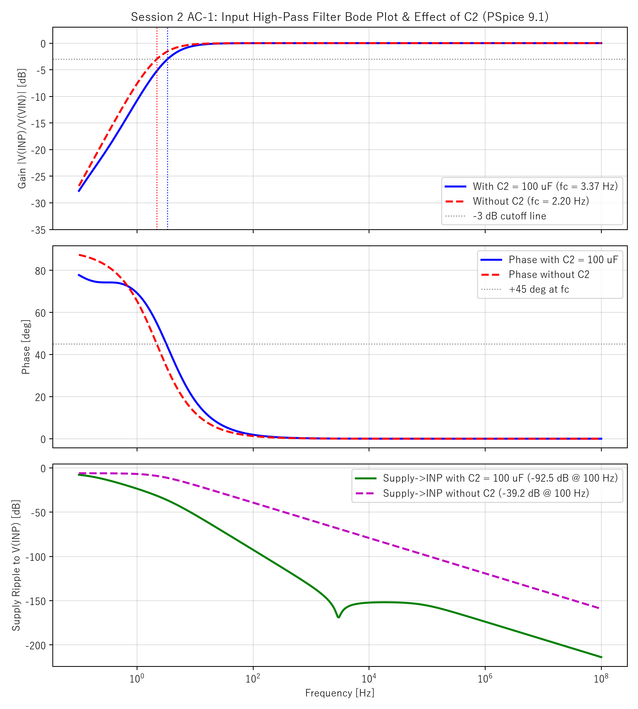
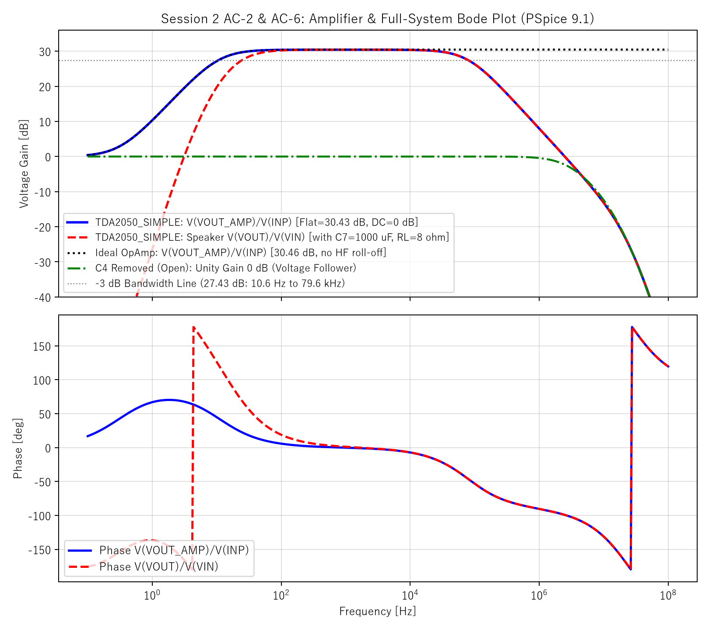
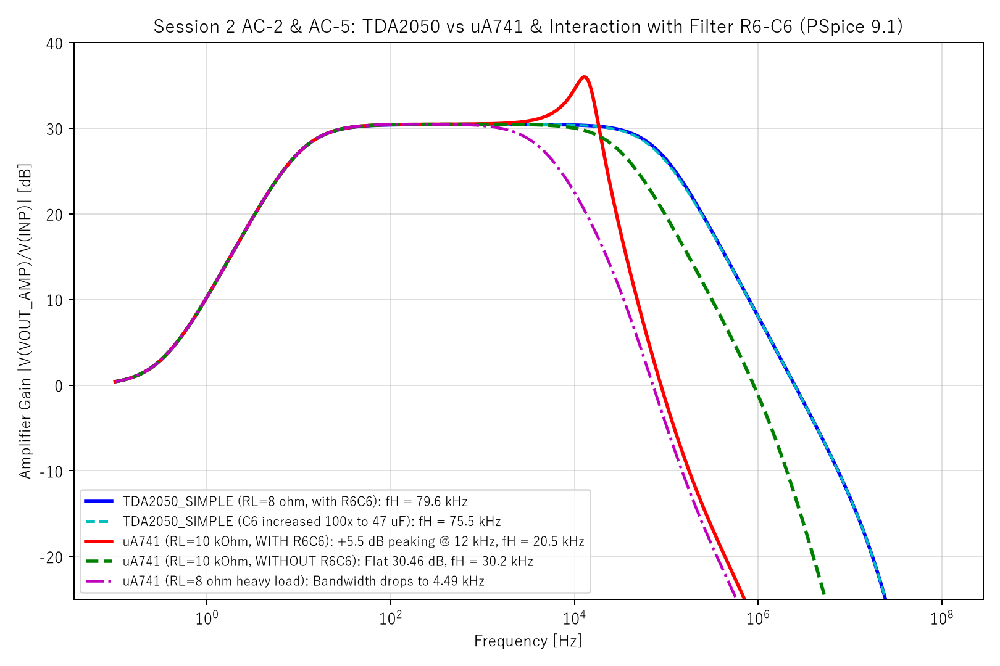
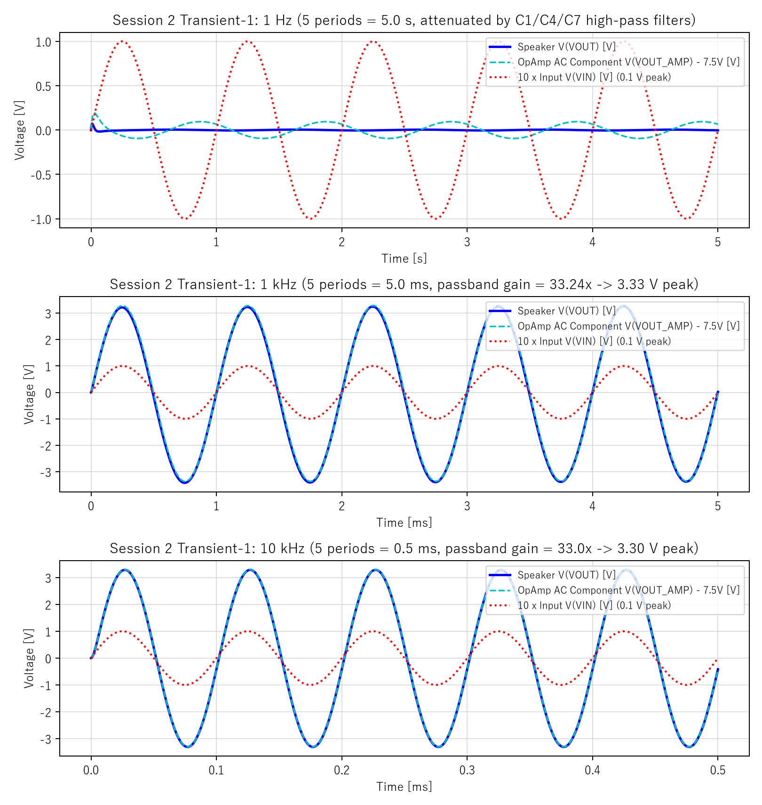
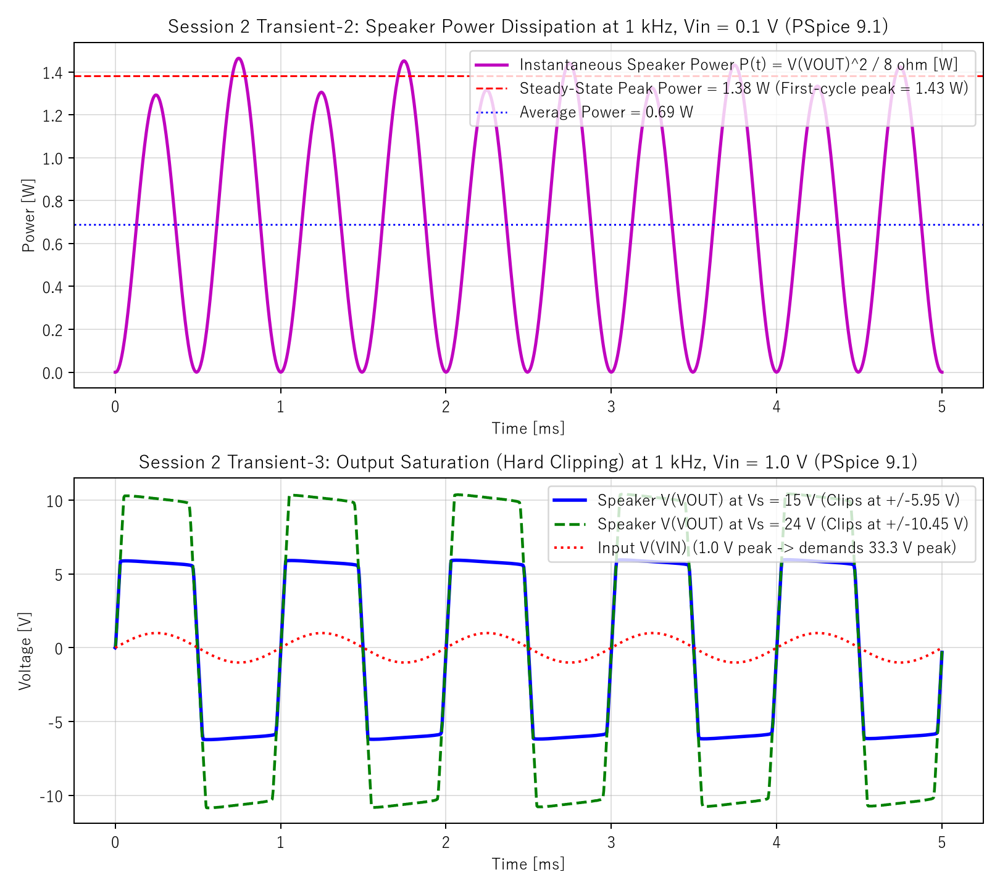
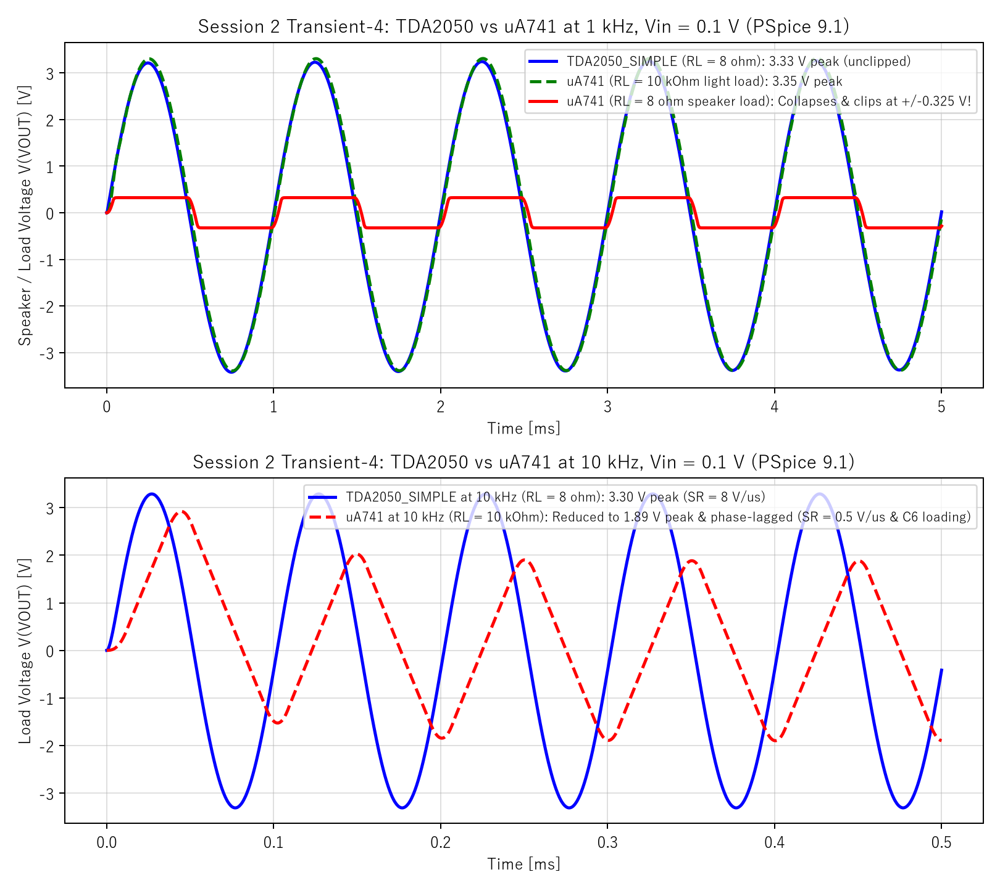

# Electric Circuits Exercises (ECE) — TDA2050 Audio Amplifier (Session 1 & 2)

TDA2050 単電源オーディオパワーアンプ（`M98TDA2050-04`）の **PSpice 9.1 回路図・1クリック共有パック・日本語解説PDF・シミュレーション結果（Excel & グラフ画像）・実験ノート（Logbook）** 一式です。

---

## 📁 収録ファイル一覧

### 1. PSpice 9.1 回路図 ＆ 1クリック自動セットアップ（友達共有用）
- **[`TDA2050_PSpice_Share.zip`](./TDA2050_PSpice_Share.zip)**（または [`TDA2050_PSpice_Share/`](./TDA2050_PSpice_Share/) フォルダ）
  - `1_Click_Setup_and_Open.bat`：**ダブルクリックするだけで `TDA2050_SIMPLE` ライブラリ登録・Windows 10/11 キャッシュエラー修正・回路図の起動まで全自動で行うスクリプト**
  - `TDA2050_Amplifier.sch` / `TDA2050_M98TDA2050_04.sch`：授業スライド写真（`Schematic.png` / `M98TDA2050-04`）と完全同一レイアウトの単電源アンプ回路図
  - `TDA2050_IdealOpAmp.sch`：理想オペアンプ比較用回路図
  - `TDA2050_uA741.sch`：汎用オペアンプ（$\mu\text{A741}$）比較用回路図
  - `TDA2050_SIMPLE.slb` / `TDA2050_SIMPLE.lib`：TDA2050 用カスタム部品シンボル＆マクロモデル
- **[`PSpice_Models/`](./PSpice_Models/)**：PSpice 9.1 回路図（`.sch`）、ネットリスト（`.net`, `.cir`）、エイリアス（`.als`）、シミュレーション出力ログ（`.out`）

### 2. 日本語解説スライドPDF（2冊）
- **[`OperationalAmplifier2026_日本語解説.pdf`](./OperationalAmplifier2026_日本語解説.pdf)**（全9ページ）
  - 講義スライド `OperationalAmplifier2026.pdf` の完全日本語解説版（理想オペアンプの3大ルール、開ループ飽和、仮想短絡・仮想接地による非反転／反転増幅の利得導出、GBWP、パッシブ／アクティブRCフィルタ、ボード線図と $-3\text{ dB}$ 帯域幅）
- **[`TDA2050_単電源回路_M98TDA2050-04_日本語解説.pdf`](./TDA2050_単電源回路_M98TDA2050-04_日本語解説.pdf)**（全2ページ）
  - 授業回路図（`Schematic.png` / `M98TDA2050-04`）の色分け図解、全15部品（$R_1\sim R_6, R_L, C_1\sim C_7$）の役割、各ノードのDCオフセット電圧（$+7.5\text{ V}$ 中点バイアスと負荷 $0\text{ V}$）、4箇所のRCフィルタのカットオフ周波数計算まとめ

### 3. シミュレーション結果・Excelグラフ・実験ノート（Logbook）
- **[`ECE_Session1_Session2_Logbook.md`](./ECE_Session1_Session2_Logbook.md)**：Session 1 & Session 2 の全課題タスク・理論計算・文献調査（スピーカーの物理動作と等価回路、コンデンサ技術比較、$1000\,\mu\text{F} \parallel 100\text{ nF}$ の並列理由）・シミュレーション考察をまとめた日本語ログブック
- **[`ECE_Session1_Session2_Results.xlsx`](./ECE_Session1_Session2_Results.xlsx)**：PSpice シミュレーション数値データと Excel ネイティブ散布図グラフを含むワークブック
- **[`Figures/`](./Figures/)**：高解像度プロット画像（6枚）

---

## 🚀 PSpice 9.1 での開き方（他のPCで動かす手順）

1. このリポジトリから **[`TDA2050_PSpice_Share.zip`](./TDA2050_PSpice_Share.zip)** をダウンロードし、右クリックして**「すべて展開（解凍）」**します。
2. 展開したフォルダ内の **`1_Click_Setup_and_Open.bat`** をダブルクリックします。
   - 自動的に `TDA2050_SIMPLE.slb` / `.lib` が PSpice 9.1 に登録され、日本語パスを含まない `C:\Users\<ユーザー名>\ECE_PSpice\` に回路図がコピーされて **PSpice Schematics** が起動します。
3. 回路図が開いたら **`F11` キー**（または上部メニュー `Analysis` → `Simulate`）を押すとシミュレーションが実行されます。
4. 回路図上部の **「`V`」アイコン（Voltage/Level Marker）** をクリックして出力線（`RL` の上）や入力線（`C1` の左）に置くか、黒いグラフ画面の **`Trace` → `Add Trace`** から `V(VOUT)` や `DB(V(VOUT)/V(VIN))` を選ぶとグラフが表示されます。

---

## 📊 シミュレーション結果プレビュー

### 1. 入力RCハイパスフィルタのボード線図

### 2. アンプ全体の周波数特性（理論値・TDA2050・理想オペアンプ比較）

### 3. スナバ回路（$R_6, C_6$）および汎用オペアンプ（$\mu\text{A741}$）の周波数特性比較

### 4. 各周波数（$5\text{ Hz}, 1\text{ kHz}, 50\text{ kHz}$）における時間領域（過渡解析）波形

### 5. 大振幅入力時のクリッピング波形と負荷消費電力

### 6. TDA2050 と $\mu\text{A741}$ の出力電流制限・波形比較

