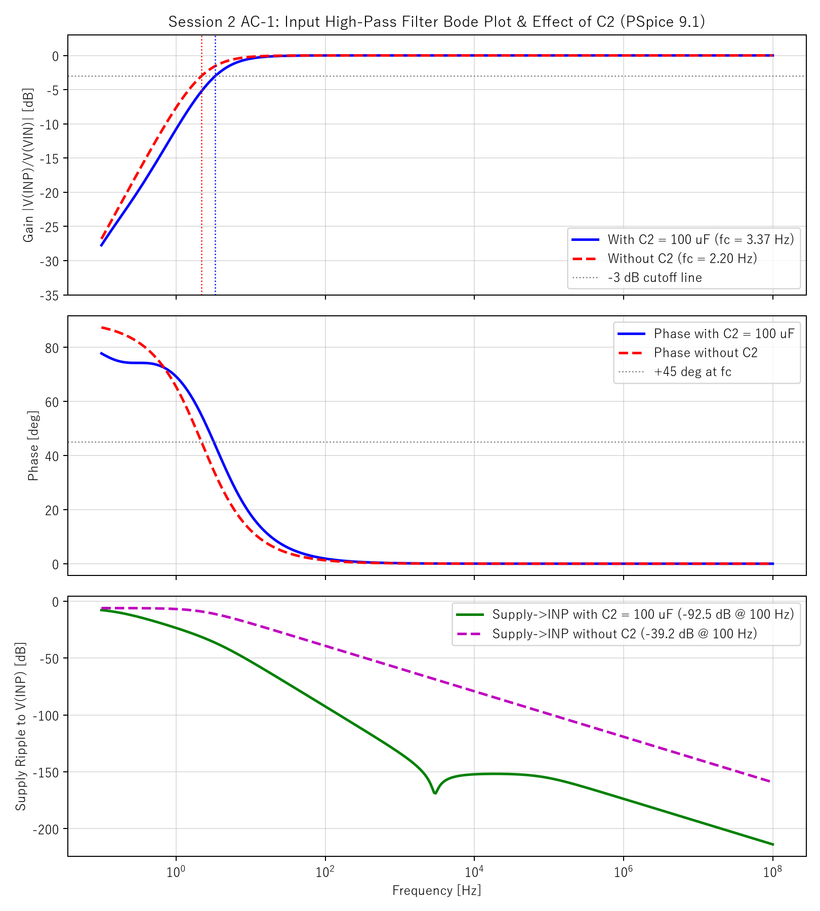
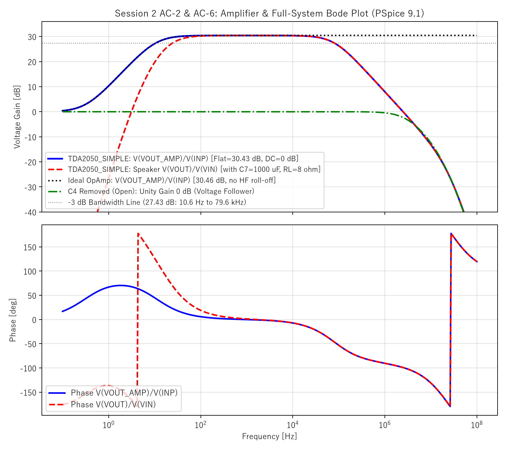
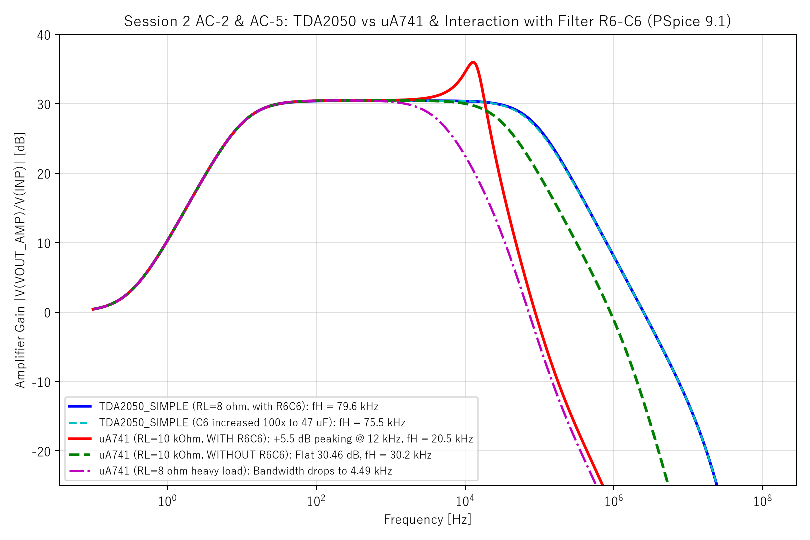
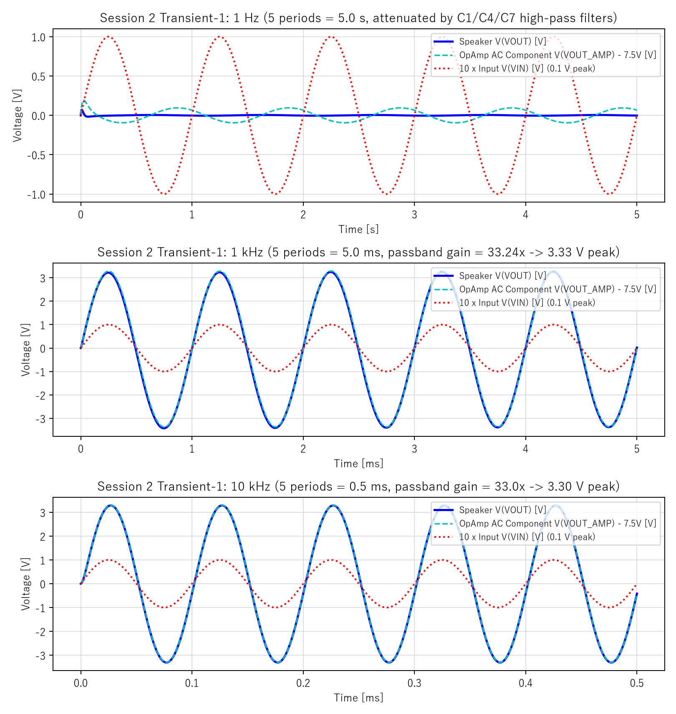
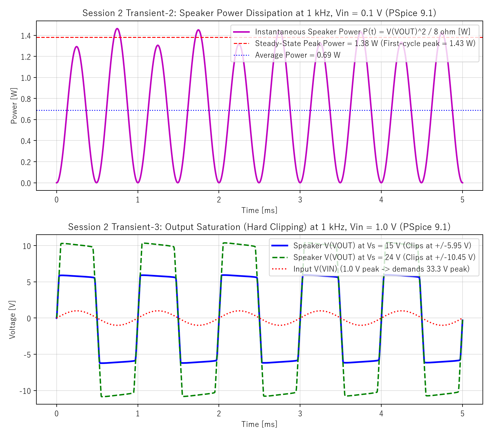
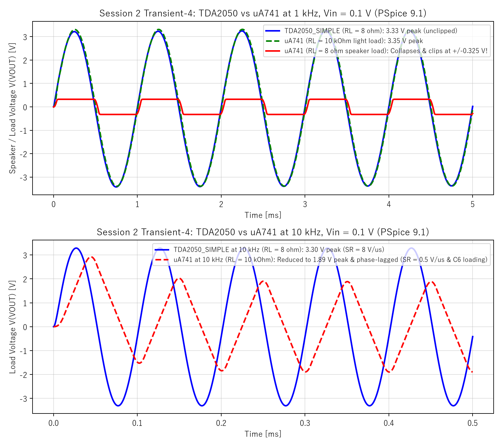

# Session 1 & 2: オペアンプ基礎・TDA2050 単電源アンプ PSpice シミュレーション

Session 1 & Session 2 の **PSpice 9.1 回路図・1クリック共有パック・シミュレーション結果（Excel & グラフ画像）・実験ノート（Logbook）** です。

---

## 📁 このフォルダの収録ファイル

- **[`TDA2050_PSpice_Share.zip`](./TDA2050_PSpice_Share.zip)**（および [`TDA2050_PSpice_Share/`](./TDA2050_PSpice_Share/)）
  - 友達のPCにそのまま送れる1クリック自動セットアップ付きパッケージ（`1_Click_Setup_and_Open.bat` をダブルクリックするだけで `TDA2050_SIMPLE` 登録＆回路図起動が完了します）
- **[`PSpice_Models/`](./PSpice_Models/)**
  - `TDA2050_Amplifier.sch` / `TDA2050_M98TDA2050_04.sch`：授業スライド写真（`Schematic.png` / `M98TDA2050-04`）と完全同一レイアウトの単電源アンプ回路図
  - `TDA2050_IdealOpAmp.sch`：理想オペアンプ比較用回路図
  - `TDA2050_uA741.sch`：汎用オペアンプ（$\mu\text{A741}$）比較用回路図
- **[`ECE_Session1_Session2_Logbook.md`](./ECE_Session1_Session2_Logbook.md)**：Session 1 & 2 の全課題・理論計算・文献調査・シミュレーション考察をまとめた実験ノート
- **[`ECE_Session1_Session2_Results.xlsx`](./ECE_Session1_Session2_Results.xlsx)**：PSpice シミュレーション数値データ＆Excel散布図グラフ集
- **[`Figures/`](./Figures/)**：高解像度プロット画像（6枚）
- **関連日本語解説PDF**：[`../Docs_Japanese_Guides/`](../Docs_Japanese_Guides/) に収録

---

## 📊 シミュレーション結果グラフ一覧

### 1. 入力RCハイパスフィルタのボード線図

### 2. アンプ全体の周波数特性（理論値・TDA2050・理想オペアンプ比較）

### 3. スナバ回路（$R_6, C_6$）および汎用オペアンプ（$\mu\text{A741}$）の周波数特性比較

### 4. 各周波数（$5\text{ Hz}, 1\text{ kHz}, 50\text{ kHz}$）における時間領域（過渡解析）波形

### 5. 大振幅入力時のクリッピング波形と負荷消費電力

### 6. TDA2050 と $\mu\text{A741}$ の出力電流制限・波形比較

